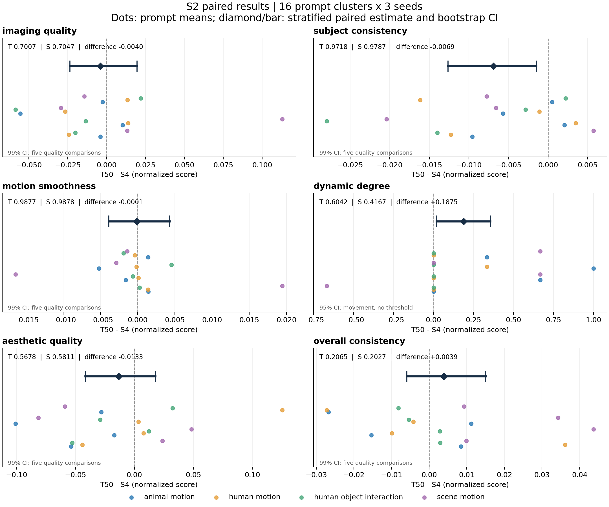
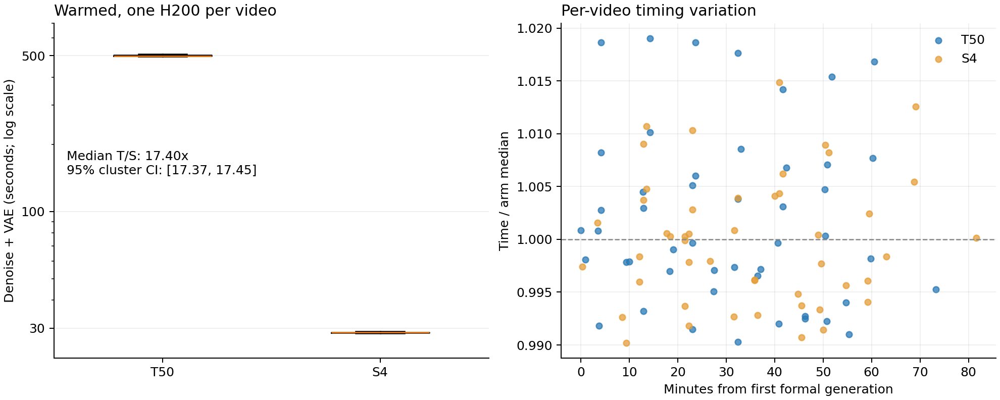

# S2 正式教师—学生资格实验报告

**96/96 条正式视频、576/576 个六指标分数、48/48 对数据完整；S3 未开始。**

## 资格结论

**本面板未建立预设的教师优势：五项质量指标为 0/5 通过。**`subject_consistency` 的教师−学生 99% 区间完全为负，支持学生在该代理指标上更高；其余四项质量差的区间均跨零。`overall_consistency` 的教师点估计略高，但证据不足。区间跨零不构成等效证明，本结果也不能外推为所有场景中教师均更弱。

教师的动态比例更高，学生的主体一致性更高，两者需要并列审视；本实验不能确定它们的因果关系。动态程度仍是运动监测项，不作为越高越好的质量目标，也不据此替代原资格判据。未更换模型、指标、seed 或阈值来追求通过。

## 六指标完整结果

分数为一次归一化后的量纲；差值始终为 T50 − S4。五质量维度采用 99% 区间，dynamic_degree 采用描述性 95% 区间。

| 指标 | T50 均值 | S4 均值 | 配对差 | 区间 | 教师优势候选 |
|---|---:|---:|---:|---|---|
| imaging_quality | 0.700690 | 0.704683 | -0.003993 | [-0.023659, +0.019500] | 否 |
| subject_consistency | 0.971771 | 0.978664 | -0.006893 | [-0.012652, -0.001480] | 否 |
| motion_smoothness | 0.987733 | 0.987840 | -0.000107 | [-0.003844, +0.004316] | 否 |
| dynamic_degree | 0.604167 | 0.416667 | +0.187500 | [+0.020833, +0.354167] | 运动变化，不作质量判定 |
| aesthetic_quality | 0.567752 | 0.581071 | -0.013319 | [-0.041540, +0.017800] | 否 |
| overall_consistency | 0.206526 | 0.202661 | +0.003865 | [-0.005935, +0.015072] | 否 |

动态视频：T50 29/48，S4 20/48；T 动/S 静 12 对，T 静/S 动 3 对，两组均动 17 对、均静 16 对。运动比例升降不按越高越好解释，不设容许界，由研究者决定可接受程度。

动态比例分别为 **60.42% 与 41.67%**，教师−学生为 **+18.75 个百分点**，95% 区间 **[+2.08, +35.42] 个百分点**。

## 真实耗时与资源

| 组 | 去噪+VAE 中位数（秒） | Q1–Q3（秒） | 每视频分支预测数 |
|---|---:|---|---:|
| T50 | 498.609 | 496.717–502.022 | 100 |
| S4 | 28.651 | 28.521–28.764 | 4 |

教师/学生中位耗时比 **17.403×**，配对 prompt 簇 bootstrap 95% 区间 [17.373, 17.452]；这是原生基线的热态实测，不是步数比例推算。

每对在同一张 H200 上依冻结顺序执行，两模型、T5、VAE 共同驻留；每 worker 各组先完成一次独立完整预热。主计时包含去噪与 VAE，CUDA 同步，不含模型加载、文本编码、源噪声传输/采样器初始化和视频编码。文本条件两组复用；这些开销另表保留，不把主计时称为冷启动端到端延迟。峰值显存含两模型共同驻留，不能当作单模型最小部署需求。十秒一次 CPU 占用监控的微小开销未扣除。

正式样本最大 allocated 显存约为 T50 **98.06 GiB**、S4 **98.02 GiB**；最大 reserved 均约 **100.16 GiB**，包含共同驻留的两份 DiT、T5 与 VAE。`worker_attempts_and_cold_start.csv` 另列全部九次 worker 启动，包括被中止的尝试、加载/预热及启动到首个/两个预热解码完成的墙钟区间。这些冷启动区间属于两模型共同驻留的服务初始化，受预热顺序影响，不能当作各模型独立部署的冷启动对照。

## 方法与限制

四类各四个 prompt，每条三个固定 seeds；先在 prompt 内平均 seeds，再四类等权。分层有放回重采样 10,000 次，PCG64 seed=20261016、float64、线性分位数；同一 prompt 的 seeds 和两组始终一起抽取。五质量指标的逐项 99% 区间为 Bonferroni 名义校正，16 簇的小样本 percentile bootstrap 不保证精确覆盖率。

本实验是冻结 16-prompt 面板的探索性资格筛查，不能外推所有提示词。Teacher 原生 FP32 参数/BF16 autocast/FP32 状态；Student 原生 BF16 参数和状态、更新以 FP32 计算再回写。两者采样器、CFG 与部署实现不同，差异不能全部归因于蒸馏训练。六指标是客观代理；overall_consistency 是文本语义一致性，不是综合质量总分。没有人工质量评分。

本阶段只有 T50 和 S4 基线，没有教师纠偏组；论文图像模型结论、Flow 代数推导和未来迁移假设均不构成本批实测迁移证据。所有质量下降、运动变化与收益均应并列审查，实际价值由研究者决定。

## 完整性、安全与产物

96 条视频均完成两种解码器的完整 81 帧、832×480、16 FPS 核查；共享源噪声/正向条件哈希逐对一致，96 个成片哈希唯一。评分有限、身份映射完整，技术异常列表：[]。原值和归一化值均保留。

失败/保护退出记录共 10 项，全部保留：两次生成任务因 GPU 0 出现额外 PID 而退出；六次首轮评测因 GPU 管理查询超过 15 秒而退出，均未提交评分；降低并发后，运动平滑度和动态程度又因 GPU 1/2 出现额外 PID 而退出。只退出自己的任务，没有终止其他进程。

生成的最后一对 `M09_seed42` 在重新确认空闲的 GPU 6 上按原输入、顺序、配置及完整预热重试；其他有效配对保留。评测后续仅在空闲 GPU 5/6 上继续。此前提交的运动平滑度 60 个、动态程度 30 个分数共 15 个完整 prompt 分块，经视频 SHA、配对身份、评分来源和归一化核对后原样复用；未完成分块才重新计算。评分工厂函数 `evaluate_s2.load_metric`、固定 VBench 源码、权重、预处理及统计脚本均未改变，恢复包装器与逐块来源另留哈希记录。没有换 seed、均值填补、删样本或按得分选择尝试。

本地从 576 行指标 CSV 和 96 行计时 CSV 复算：NumPy 2.4.3 与远端 NumPy 1.26.4 的均值、配对区间及资格判定完全一致（本次最大差为 0）。共八次教师、八次学生完整预热的源噪声、正向条件及最终 latent 哈希均与各自 S1 结果一致。16 个 prompt 的条件哈希、三个 seed 的源噪声哈希跨 worker 一致。正式循环之外记录的 `student_initial_cast_sha256`/误差为 CPU 上计算的预期 BF16 转换值；实际原生状态 dtype 在每步检查，S1 另有 GPU 实测转换记录，不能把该 CPU 派生字段当作逐步 GPU 轨迹记录。

结束核查确认自身 GPU 上下文均已释放，24 项共享生成文件大小和 mtime 与完整哈希验收时一致；无新增模型、环境安装或他人目录修改。运行失败的明细见 `statistics.json`，最终资源核查在 `runs/s2_20261016/final_safety_audit.json`。

- `metrics_per_video.csv`：576 条逐视频指标，含原值、归一化值和成片哈希。
- `metrics_wide.csv`：96 行，便于逐视频同时查看六指标与主耗时。
- `paired_metrics.csv`、`prompt_means.csv`、`stratum_means.csv`：配对、prompt 和分层结果。
- `statistics.json`、`metric_summary.csv`：区间、资格候选、动态转移及统计设置。
- `timing_per_video.csv`、`timing_by_gpu.csv`、`load_and_warmup.csv`：热态、加载、预热、文本/导出等分项。
- `worker_attempts_and_cold_start.csv`、`analysis_crosscheck.json`：全部 worker 尝试、冷启动分项和本地复算证据。
- `video_index.json/csv`：原视频及按 T50/S4 分组归档路径、SHA-256。
- 归档：`Evaluation_Videos/s2_20261016/T50/` 与 `S4/`，各 48 条，复制后核对哈希。

`core_evidence.tar.gz` 与其清单保存复核前的原始证据快照（包括首次自动报告）；最新报告、图表及交付文件的哈希以 `DELIVERY_MANIFEST.json` 为准。本地仅同步脚本、文档、CSV/JSON、必要日志与小图，视频、latent、权重及环境留在远端。

**停在 S2：当前未满足预设教师优势前提，S3 未启动。等待研究者决定后续研究任务。**
